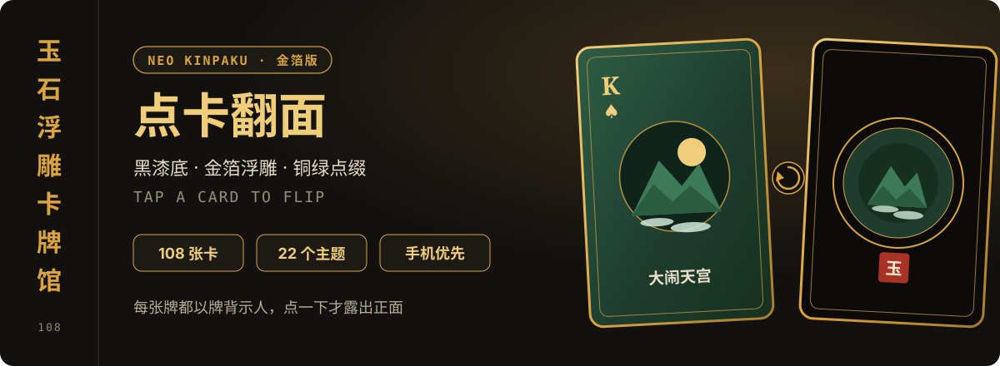
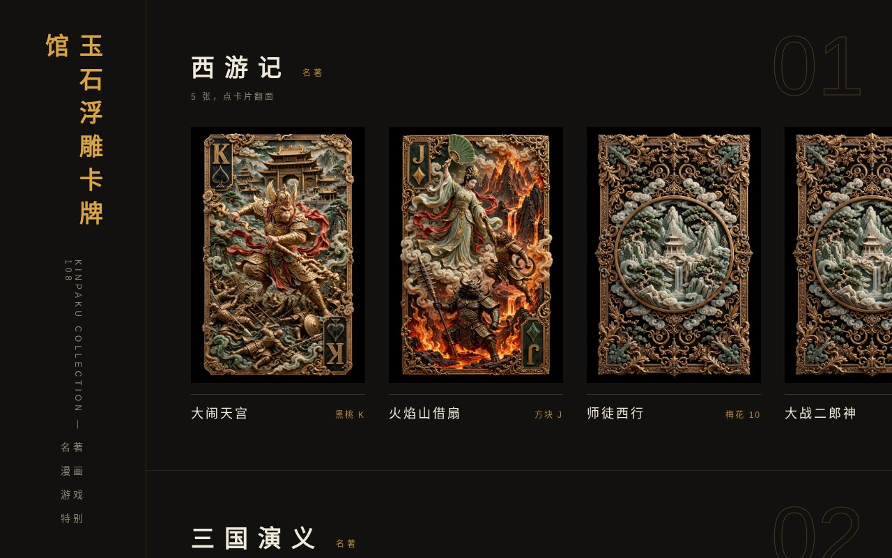
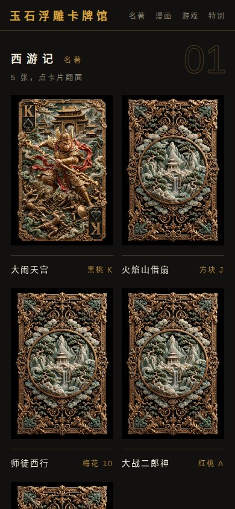

<p align="right"><a href="README.md">中文</a></p>

<p align="center">
  
</p>

<p align="center">
  <a href="https://holynova.github.io/jade-kinpaku-cards/">▶ Visit the Gallery</a>
  ·
  <a href="https://github.com/holynova/jade-kinpaku-cards">GitHub Repository</a>
</p>

Jade Relief Cards · Kinpaku is a standalone single-page edition of the 108 jade-relief playing cards, in Neo Kinpaku style — black lacquer, gold-leaf relief, verdigris accents. Every card starts face-down; tap to flip it over. A vertical gold title rail and gilt chapter numbers make it feel like walking through a gallery, one chapter at a time. Mobile-first, pure static page.

## Screenshots

<p align="center">
  
  
</p>

## Collection

108 cards, 4 categories, 22 themes, 5 cards per theme (plus 3 Ace Collection cards):

| Category | Cards | Themes |
| :--- | :---: | :--- |
| 名著 (Classics) | 35 | 西游记 (Journey to the West), 三国演义 (Romance of the Three Kingdoms), 水浒传 (Water Margin), 红楼梦 (Dream of the Red Chamber), 聊斋志异 (Strange Tales from a Chinese Studio), 封神演义 (Investiture of the Gods), 史记 (Records of the Grand Historian) |
| 漫画 (Comics) | 35 | 龙珠 (Dragon Ball), 海贼王 (One Piece), 火影忍者 (Naruto), 鬼灭之刃 (Demon Slayer), 哆啦A梦 (Doraemon), 名侦探柯南 (Detective Conan), 灌篮高手 (Slam Dunk) |
| 游戏 (Games) | 35 | 黑神话：悟空 (Black Myth: Wukong), 艾尔登法环 (Elden Ring), 塞尔达传说 (The Legend of Zelda), 原神 (Genshin Impact), 宝可梦 (Pokémon), 王者荣耀 (Honor of Kings), 超级马里奥 (Super Mario) |
| 特别 (Special) | 3 | 王牌珍藏 (Ace Collection: 九龙玉玺 Nine-Dragon Jade Seal, 和氏璧 He's Jade, 广告牌 Billboard) |

Every card has a poker rank (e.g. 「大闹天宫 · 黑桃 K」 — Havoc in Heaven · King of Spades); the shared card back is a jade landscape relief medallion.

## Experience

- **Tap to flip**: cards start face-down; click (or press Enter / Space) to flip them in 3D and reveal the front; tap again to flip back.
- **Chaptered display**: 22 themed chapters, each a horizontally scrolling row of 5 cards with a gilt chapter number (01, 02, …) at the top right.
- **Vertical navigation**: on desktop, a vertical gold title rail on the left with category links （名著 Classics / 漫画 Comics / 游戏 Games / 特别 Special) for one-tap jumps; on mobile it collapses to a top bar.
- **Lazy loading**: images use `loading="lazy"`, loading as you scroll.

## How It Differs from jade-cards-lab

Same 108 jade cards, two different ways of showing them:

| | jade-kinpaku-cards (this repo) | jade-cards-lab |
| :--- | :--- | :--- |
| Display | Chapters by theme, horizontal scroll | Flat grid + category filters |
| Interaction | Tap a card to flip it in 3D | Hover for 3D tilt + lightbox zoom |
| Navigation | Vertical title rail on the left | Filter bar at the top |
| Images | Referenced from jade-relief-cards | Full images + thumbnails in-repo |

## Run Locally

Zero build, pure static page — just serve it (internet required to load images, which are hosted on the jade-relief-cards repo's GitHub Pages):

```bash
python3 -m http.server 8000
# Open http://localhost:8000
```

## Tech

- Pure HTML + CSS + JS single page, zero dependencies, zero build; card data lives in `data.js` (the `CARDS` array, 108 entries).
- Flipping uses CSS `preserve-3d` + `rotateY(180deg)` with a 0.7s ease; cards are keyboard-operable (`tabindex` + Enter / Space).
- Images are not in this repo: `IMG` in `data.js` points to `holynova.github.io/jade-relief-cards/img/`.

```
index.html      The whole single page: styles + rendering + flip interaction
data.js         Data for 108 cards + image URLs (pointing to jade-relief-cards)
assets/screenshot.png   Old screenshot (card backs only)
```

## Note

The card artwork is AI-generated in a jade relief style; characters and stories are drawn from classic works and pop culture, and their rights belong to their respective owners.
