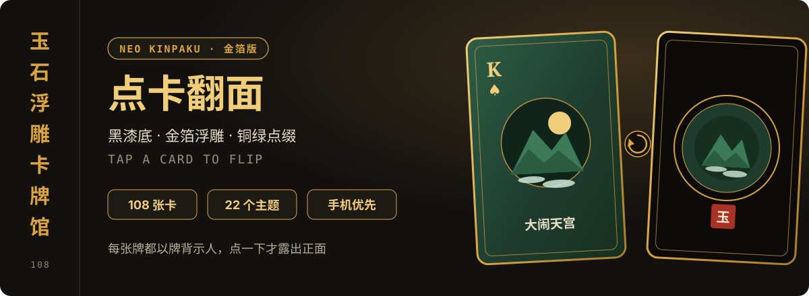
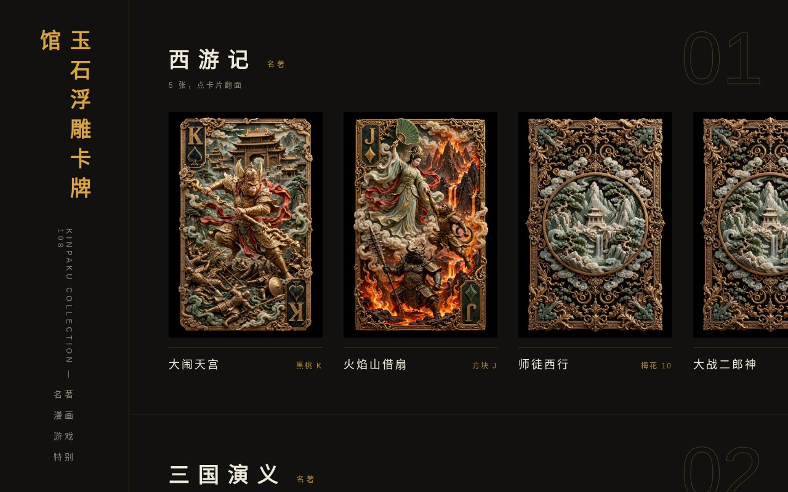
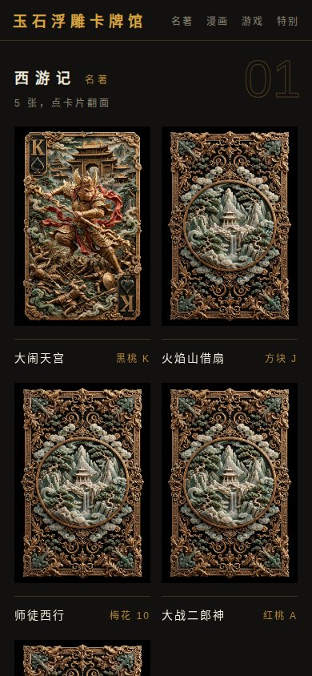

<p align="right"><a href="README.en.md">English</a></p>

<p align="center">
  
</p>

<p align="center">
  <a href="https://holynova.github.io/jade-kinpaku-cards/">▶ 在线逛馆</a>
  ·
  <a href="https://github.com/holynova/jade-kinpaku-cards">GitHub 仓库</a>
</p>

玉石浮雕卡牌馆 · 金箔版是 108 张玉石浮雕扑克的独立单页版：Neo Kinpaku 风格——黑漆底、金箔浮雕、铜绿点缀。每张牌都以牌背示人，点一下才翻出正面；左侧竖排馆名、每章一个描金序号，像在展厅里一章一章逛过去。手机优先，纯静态单页。

## 截图

<p align="center">
  
  
</p>

## 收录

108 张卡，4 大类别，22 个主题，每个主题 5 张（王牌珍藏 3 张）：

| 类别 | 张数 | 主题 |
| :--- | :---: | :--- |
| 名著 | 35 | 西游记、三国演义、水浒传、红楼梦、聊斋志异、封神演义、史记 |
| 漫画 | 35 | 龙珠、海贼王、火影忍者、鬼灭之刃、哆啦A梦、名侦探柯南、灌篮高手 |
| 游戏 | 35 | 黑神话：悟空、艾尔登法环、塞尔达传说、原神、宝可梦、王者荣耀、超级马里奥 |
| 特别 | 3 | 王牌珍藏（九龙玉玺、和氏璧、广告牌） |

每张卡都有扑克牌面（如「大闹天宫 · 黑桃 K」）；卡背是统一的玉石山水浮雕圆章。

## 体验

- **点卡翻面**：卡牌默认显示牌背，点击（或键盘 Enter / 空格）以 3D 翻转露出正面，再点翻回。
- **章节式展陈**：按主题分 22 章，每章横向滚动一排 5 张，右上角有描金序号（01、02……）。
- **竖排导航**：桌面端左侧竖排馆名 + 类别导航（名著 / 漫画 / 游戏 / 特别），一点直达；移动端收成顶部横条。
- **懒加载**：图片 `loading="lazy"`，滑到哪加载到哪。

## 与 jade-cards-lab 的区别

同是 108 张玉石卡，两个版本展陈方式不同：

| | jade-kinpaku-cards（本仓） | jade-cards-lab |
| :--- | :--- | :--- |
| 展陈 | 按主题分章，横向滚动 | 全部平铺网格 + 分类筛选 |
| 交互 | 点卡 3D 翻面 | 悬停 3D 倾斜 + 灯箱大图 |
| 导航 | 左侧竖排馆名 | 顶部筛选条 |
| 图片 | 引用 jade-relief-cards 的图 | 仓库自带全图 + 缩略图 |

## 本地运行

零构建，纯静态页面，直接起一个静态服务器（需联网加载图片，图片托管在 jade-relief-cards 仓库的 GitHub Pages）：

```bash
python3 -m http.server 8000
# 打开 http://localhost:8000
```

## 技术

- 纯 HTML + CSS + JS 单页，零依赖、零构建；卡牌数据在 `data.js`（`CARDS` 数组，108 条）。
- 翻面用 CSS `preserve-3d` + `rotateY(180deg)`，0.7s 缓动；卡片可键盘操作（`tabindex` + Enter / 空格）。
- 图片不在本仓库：`data.js` 里的 `IMG` 指向 `holynova.github.io/jade-relief-cards/img/`。

```
index.html      单页全部内容：样式 + 渲染 + 翻面交互
data.js         108 张卡的数据 + 图片地址（指向 jade-relief-cards）
assets/screenshot.png   旧截图（仅牌背）
```

## 说明

卡牌图案为 AI 生成的玉石浮雕风格艺术图，人物与故事取材自经典作品与流行文化，版权归各自权利人所有。
