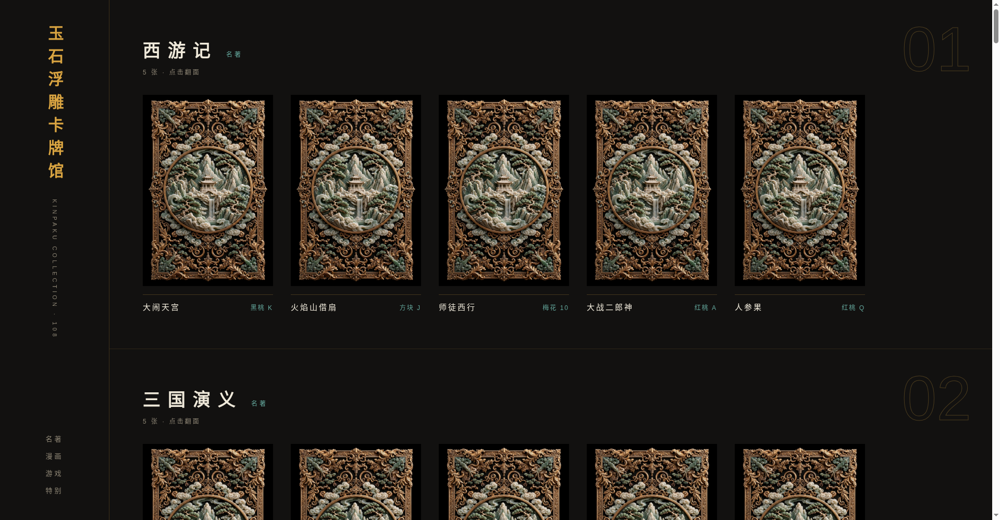

# 玉石浮雕卡牌馆 · 金箔 / Jade Relief Cards · Kinpaku

中文：玉石浮雕卡牌馆的金箔独立版——108 张卡（名著 / 漫画 / 游戏 / 特别四类），Neo Kinpaku 风格：黑漆底 + 金箔浮雕 + 铜绿点缀，点击卡片翻面。纯静态单页，手机优先。

English: Standalone Kinpaku edition of the jade-relief card gallery — 108 cards across Classics / Manga / Games / Specials in Neo Kinpaku style (black lacquer, gold-leaf relief, verdigris accents). Tap a card to flip. Pure static single page, mobile-first.



## 在线体验 / Live Demo

- [Cloudflare Demo](https://xiaosang.cc/jade-kinpaku-cards/)
- [GitHub Repo](https://github.com/holynova/jade-kinpaku-cards)


## 本地运行 / Run locally

```bash
python3 -m http.server 8000
# 打开 http://127.0.0.1:8000/
```

## 发布 / Deploy

```bash
npx --yes wrangler@4.128.0 deploy --dry-run --config wrangler.jsonc
npx --yes wrangler@4.128.0 deploy --config wrangler.jsonc
```

Cloudflare Workers · Domain: `xiaosang.cc` · Route: `/jade-kinpaku-cards/`

源码与部署配置使用同一个主分支（main）；在本地手动发布，不创建 Cloudflare 专用分支或 GitHub Action。GitHub Pages 保留作回退。
